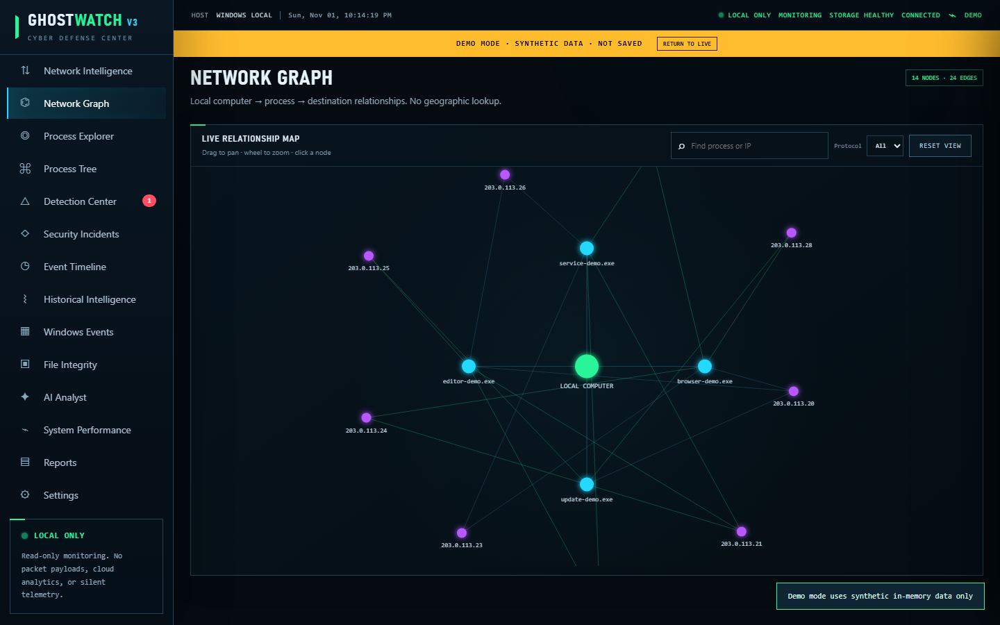

# GhostWatch V3

GhostWatch V3 is a local-first Windows monitoring and investigation dashboard. It collects system, process, connection, Windows Event Log, and explicitly enrolled file-integrity metadata; applies explainable detection rules; streams bounded updates to a browser dashboard; and stores selected history in local SQLite.

The current build is a **local beta accepted with limitations**. It is intended for a single Windows user on one computer. It is not an antivirus product, an endpoint protection replacement, a remote scanner, a penetration-testing toolkit, or a claim that a computer is free of compromise.



> Current V3 interface captured in Demo Mode. Every process, address, alert, and relationship shown is synthetic and remains in browser memory; it is not saved as host telemetry.

## Current verification status

The final Windows closeout run reported:

- **222 Python tests passed**
- **15 Playwright tests passed** using synthetic REST and WebSocket data
- **77 focused release-security tests passed**
- Ruff, Python compilation, JavaScript syntax, PowerShell parsing, SQLite integrity, and live Host/Origin/WebSocket checks passed

Those figures are from the Windows closeout environment on October 27, 2026. They are not results from the separate independent Linux source audit. See [Current Beta Validation](docs/CURRENT_BETA_VALIDATION.md) for scope, commands, warnings, and limitations. RC2 through RC5 records are retained as historical engineering evidence and are indexed separately in [Documentation](docs/README.md).

## Feature overview

- **Live system telemetry** — CPU, memory, disk, network rates, uptime, collection health, and bounded WebSocket updates.
- **Process monitoring** — process inventory, search, sorting, detail drawer, process tree, access-status indicators, and historical observations.
- **Network intelligence** — full-list aggregate socket counts, a capped detail view, connection ownership where Windows exposes it, rankings, lifecycle summaries, and a relationship graph.
- **Detection and incidents** — explainable threshold and baseline rules, grouped collection failures, alert acknowledgement/dismissal, and local incident case tracking.
- **Historical analytics** — durable CPU, memory, network, process, and connection observations with time-range queries, rollups, retention, missing-data gaps, and selected export.
- **File integrity** — opt-in monitored folders, SHA-256 baselines, create/modify/delete detection, deduplication, and path-safety controls.
- **Windows Event Logs** — incremental, read-only Defender, System, and Application summaries with cursor recovery and permission-aware degradation.
- **Privacy-safe reports** — redacted JSON, CSV, and HTML reports with spreadsheet-formula neutralization and explicit raw-data boundaries.
- **Optional local AI** — disabled by default; when enabled, analysis is sent only to a user-configured loopback Ollama endpoint with no cloud fallback or tool access.

## Architecture

```text
Windows host collectors
  system | processes | sockets | event logs | file integrity
                         |
                         v
                 monitoring service
              / detection / baselines \
             v                         v
      SQLite schema v3          bounded live state
      WAL + retention           alerts + telemetry
             \                         /
              v                       v
          FastAPI REST + secured WebSocket
                         |
                         v
          dependency-free HTML/CSS/JavaScript UI
```

- `app/monitoring/` isolates system, network, process, Windows-event, and file-integrity collection failures.
- `app/detection/` contains explainable duration/cooldown rules and baseline evaluation.
- `app/storage/` owns schema-v3 migrations, WAL handling, retention, rollups, incidents, settings, and recovery.
- `app/api/` exposes the loopback REST and WebSocket interfaces.
- `app/reporting.py`, `app/privacy.py`, and `app/ai.py` implement reporting, redaction, and optional local analysis boundaries.
- `frontend/` is a dependency-free dashboard with Canvas charts and isolated Demo Mode.
- `tests/` and `e2e/` contain backend/security regressions and synthetic Playwright flows.

## Security and privacy boundaries

- The supported launcher binds Uvicorn only to `127.0.0.1:8765`.
- Exact HTTP `Host` and unsafe-request `Origin` checks protect the intended browser boundary.
- WebSockets require an allowed `Host` and exact dashboard `Origin`; client count and sends are bounded.
- No packet payloads are captured, no remote systems are scanned, and GhostWatch does not block traffic or terminate processes.
- Runtime databases, WAL/SHM files, logs, test artifacts, environments, and real telemetry screenshots are excluded from public release archives.
- Windows permissions may limit process names, executable metadata, socket ownership, or Event Log visibility. GhostWatch reports degraded or unavailable collection rather than inventing data.
- The Windows user account is the local trust boundary. Host/Origin checks are not authentication for another native process running as that same user.
- Raw Windows event data remains local. Dashboard and default export paths redact usernames, SIDs, home directories, and sensitive paths.
- Optional AI is not a security verdict. Its output must be treated as an analyst aid and verified against local evidence.

Do not expose GhostWatch through a LAN listener, public reverse proxy, or port-forwarding rule. This project has not been certified by penetration testing.

## Requirements

- Windows 10 or Windows 11
- PowerShell
- Python 3.11 or newer
- Node.js 20 or newer only when running Playwright tests

## Installation and startup

Clone or extract the source into a normal user-writable folder, then run:

```powershell
cd C:\projects\ghostwatch-v3
powershell -ExecutionPolicy Bypass -File .\start.ps1
```

The launcher creates `.venv` if needed, installs pinned Python dependencies only when `requirements.txt` changes, rejects Python versions below 3.11, checks that port 8765 is free, waits for the health endpoint, and opens the dashboard when possible. Use `-NoBrowser` to suppress browser launch.

Manual startup:

```powershell
python -m venv .venv
.\.venv\Scripts\python.exe -m pip install -r requirements.txt
.\.venv\Scripts\python.exe -m uvicorn app.main:app --host 127.0.0.1 --port 8765
```

Open <http://127.0.0.1:8765>. Keep the PowerShell window open and press `Ctrl+C` there to stop GhostWatch.

### Demo Mode

Open **Settings**, select **Enter Demo Mode**, and navigate through the dashboard. The yellow banner identifies the mode as synthetic and not saved. Demo Mode does not scan local folders or persist its observations.

## Testing

Python and static checks:

```powershell
.\.venv\Scripts\python.exe -m pytest
.\.venv\Scripts\python.exe -m ruff check .
.\.venv\Scripts\python.exe -m compileall -q app scripts
```

Browser tests:

```powershell
npm ci
npx playwright --version
npx playwright install --dry-run
npm run test:e2e
```

Browser binaries are not bundled with the repository. Review the dry-run output before installing any missing browser. The checked-in suite uses synthetic data and starts a temporary loopback server.

## Troubleshooting

- **Python is too old:** install Python 3.11 or newer, then recreate `.venv`.
- **Port 8765 is occupied:** stop the application that owns the port or choose a different time to run GhostWatch; do not expose a different network interface.
- **Dashboard does not open automatically:** browse to `http://127.0.0.1:8765` after the launcher reports a healthy server.
- **Process or network details are partial:** run without privilege escalation first and review the collection-status indicators. Protected Windows processes and socket providers may intentionally hide metadata.
- **Windows events are unavailable:** confirm the relevant log is readable by the current account. GhostWatch does not alter Event Log permissions.
- **Playwright browser is missing:** run `npx playwright install --dry-run`, review the proposed downloads, and install only the browser you intend to test.
- **Database recovery warning:** stop GhostWatch and preserve the database plus matching `-wal` and `-shm` files before attempting manual recovery.

## Documentation and release history

- [Documentation index](docs/README.md)
- [Current beta validation](docs/CURRENT_BETA_VALIDATION.md)
- [GitHub publication checklist](docs/GITHUB_PUBLICATION_CHECKLIST.md)
- [MIT license decision record](docs/LICENSE_OPTIONS.md)
- [Third-party notices](docs/THIRD_PARTY_NOTICES.md)
- [Public asset provenance](docs/ASSET_PROVENANCE.md)

Historical RC2–RC5 documents describe the state and evidence of those candidates; they are not the current beta status. Older design images are explicitly catalogued as concepts/mockups in the documentation index.

## License status

GhostWatch-authored source and documentation are available under the [MIT License](LICENSE):

`Copyright (c) 2026 Rafi Dahoui`

Third-party dependencies, optional tools, browser binaries, models, system fonts, and other third-party components remain under their own applicable terms. See [Third-Party Notices](docs/THIRD_PARTY_NOTICES.md). The two historical concept images in the private working directory are not licensed for public redistribution and are excluded from release archives.

